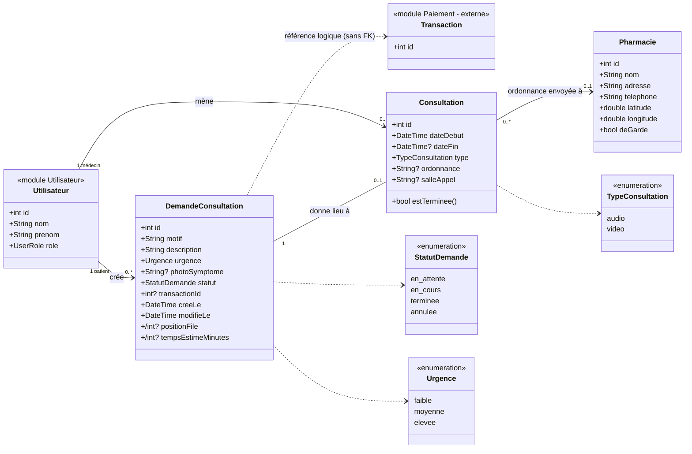
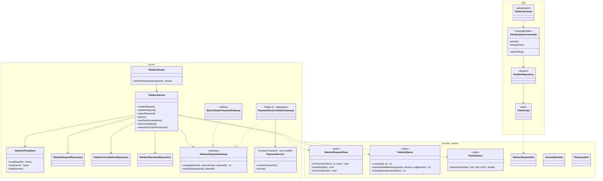
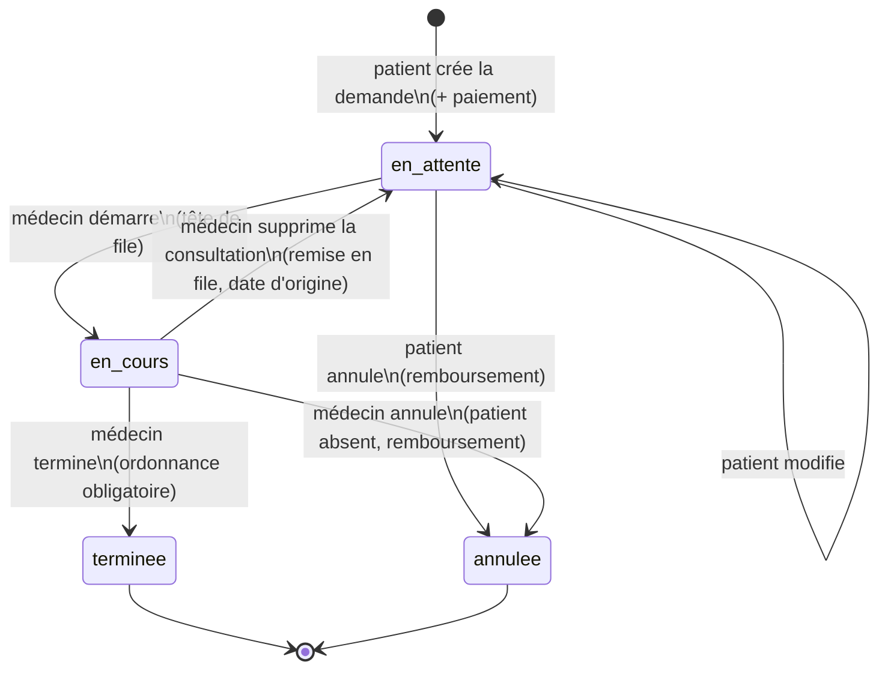
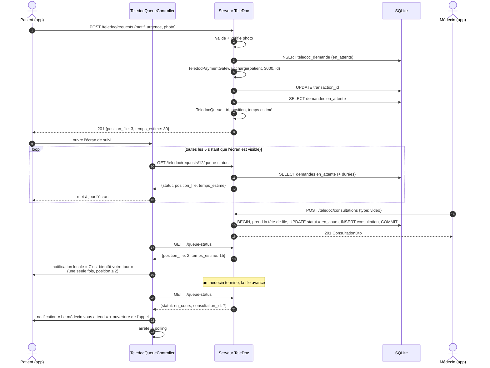
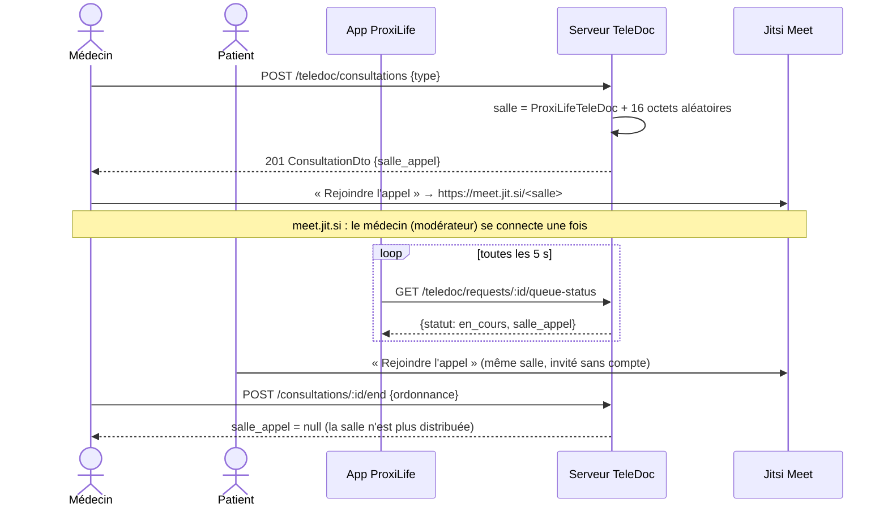

# TeleDoc Express — Conception (Étape 1)

Module de téléconsultation de ProxiLife. Ce document est la référence de
conception : modèle de données, API REST, machine à états et file d'attente.

## 0. Décisions de conception

| # | Décision | Justification | Alternative écartée |
|---|---|---|---|
| D1 | Le **patient** est un utilisateur de rôle `client`, le médecin un rôle `medecin` (rôles existants de `UserRole`). | Réutilise l'auth du module Utilisateur. | Nouveau rôle `patient` : dupliquerait `client`. |
| D2 | `position_file` et `temps_estime` (attributs du cahier des charges) sont des **attributs dérivés** (notés `/` en UML) : présents dans l'entité et le DTO, mais calculés à chaque lecture, jamais stockés. | Toujours justes, même après une annulation ou l'arrivée d'une urgence ; aucun recalcul en cascade à maintenir. | Colonnes stockées : à recalculer pour toute la file à chaque changement (risque d'incohérence). |
| D3 | **File commune avec priorité** : tri par urgence (`elevee` > `moyenne` > `faible`), puis par date de création. | Logique médicale (triage) ; rend la file « dynamique » (une urgence peut passer devant). | FIFO pur : ignore l'urgence. |
| D4 | Le médecin **prend toujours la tête de file** (pas de choix libre), de façon atomique. | Équité + deux médecins ne peuvent pas prendre la même demande. | Choix libre dans la liste : risque de « trier » les patients. |
| D5 | Un médecin a **au plus une consultation en cours** (index unique partiel SQLite). | Garantie au niveau base, même en cas de requêtes simultanées. | Contrôle uniquement applicatif : course possible. |
| D6 | Photo envoyée en **base64 dans le JSON**, vérifiée par signature (JPEG `FF D8 FF`, PNG `89 50 4E 47`), ≤ 2 Mo décodés, stockée sous un nom aléatoire dans `server/uploads/teledoc/` (ignoré par git). Servie via un endpoint authentifié. | Pas de modification d'`ApiClient` ; nom aléatoire = pas de traversée de chemin ni de devinette d'URL. | Multipart : modifie `ApiClient` (partagé). |
| D7 | Règles de statut, tri de la file, estimation du temps et Haversine en **Dart pur dans `proxilife_shared`**. | Une seule source de vérité (comme `TransactionRules`), testable avec `dart test`, utilisable par l'app et le serveur. | Logique dupliquée app/serveur. |
| D8 | Clés étrangères vers `utilisateur` en `ON DELETE CASCADE` (patient) / `SET NULL` (médecin). | La suppression de compte du module Utilisateur fait un `DELETE` réel : il ne faut pas la bloquer. | `RESTRICT` : casserait la suppression de compte. |
| D9 | Noms de colonnes alignés sur l'existant : `patient_id`, `demande_id`, `medecin_id`, `pharmacie_id` (le cahier des charges écrit `id_patient`…). URLs en anglais, clés JSON en français snake_case, comme `/transactions` + `montant_centimes`. | Cohérence avec le reste du projet. | — |
| D10 | Suppression d'une consultation **seulement si elle n'est pas terminée** (prise en charge par erreur) : la demande revient en file avec sa date d'origine. Une consultation terminée est un dossier médical : modifiable (correction d'ordonnance), pas supprimable. | Intégrité du dossier médical. | Suppression libre : perte d'historique et d'ordonnance. |
| D11 | Le paiement passe par une **interface `TeledocPaymentGateway`** (côté serveur) ; implémentation **mock** par défaut. TeleDoc ne stocke qu'un `transaction_id` nullable **sans clé étrangère**. | Le module Paiement appartient à un autre membre (Fawzi) : TeleDoc l'appelle sans en dépendre, et le mock se remplace en une ligne. | Écrire dans `transaction_` ou ajouter un compte spécial : toucherait au module Paiement / Utilisateur. |
| D12 | Entité **`Pharmacie`** ajoutée (absente du cahier des charges). | Nécessaire pour `id_pharmacie` et la localisation de la pharmacie de garde. | Coordonnées en dur dans l'app : non maintenable. |
| D13 | Migration : `database.dart` passe en `version: 2` (littéral, version **globale** du projet) avec `onUpgrade: upgradeTeledocSchema`. Le SQL vit dans `teledoc_schema.dart`. | Diff minimal dans un fichier partagé ; un autre module pourra chaîner une v3. | Constante `teledocSchemaVersion` dans `database.dart` : laisserait croire que la version appartient à TeleDoc. |
| D14 | Seed : médecins = comptes `medecin` ordinaires (mot de passe de démo, RIB valide calculé par `computeRibKey`). Les demandes de démo ont `transaction_id = NULL` (jamais payées). Le seed est idempotent : upsert par e-mail, insertion seulement si la table est vide. | Le seed peut être relancé sans doublon ; aucune fausse transaction. | Simuler un paiement dans le seed : mélangerait données de démo et paiements. |
| D15 | **Une seule demande active** (`en_attente` ou `en_cours`) par patient ; sinon 409. | Évite qu'un patient occupe plusieurs places dans la file. | Plusieurs demandes simultanées : file faussée, paiements multiples. |
| D16 | Le **type d'appel** (audio/vidéo) n'est modifiable que pendant la consultation ; l'**ordonnance** reste corrigeable après la fin. | Le type est un fait historique une fois l'appel passé ; une ordonnance peut contenir une erreur à corriger. | Tout modifiable : historique non fiable. |
| D17 | Annulation par le médecin d'une consultation en cours (patient absent) : la demande passe à `annulee` et la consultation est **close** (`date_fin` renseignée, sans ordonnance). | Libère le médecin (index unique partiel) et garde une trace de la tentative. | Supprimer la consultation : perte de traçabilité. |
| D18 | Annulation : **remboursement d'abord**, changement de statut ensuite. Si le remboursement est refusé : 409 et la demande reste inchangée. | On n'annule jamais une demande payée sans avoir rendu l'argent. | Statut d'abord : demande annulée mais non remboursée en cas d'échec. |
| D19 | Point d'entrée **`buildTeledocModule(db)`** dans `teledoc_routes.dart` ; `app.dart` n'a qu'une ligne `..mount(...)`. Le mock est la valeur par défaut **dans ce fichier TeleDoc**. | Brancher le vrai paiement (Étape 11) ne touche aucun fichier partagé ; les tests injectent une passerelle espion et un dossier d'uploads temporaire. | Paramètres ajoutés à `buildApp` : modifie la signature d'un fichier partagé. |
| D20 | Les champs JSON d'un mauvais type (ex. `"motif": 42`) donnent un **400** explicite, pas un 500. | Un `as String` raté serait capturé comme erreur interne par `guard`. | Casts directs comme dans les autres modules. |
| D21 | `TeledocQueueService` construit un **instantané** de la file (lignes triées, positions, `M`, `D`) en une lecture ; tous les endpoints l'utilisent, y compris dans la transaction de prise en charge. | Une seule logique de calcul côté serveur (celle de `TeledocQueue`, partagée), état cohérent pendant la prise de la tête de file. | Calcul dispersé dans chaque endpoint. |
| D22 | Prise de la tête de file : transaction + `UPDATE ... WHERE statut = 'en_attente'` (on vérifie qu'une ligne a changé) + index unique partiel. File vide : 404 ; consultation déjà ouverte : 409. | Triple garde contre les doubles prises, testée avec deux médecins simultanés. | Simple lecture puis écriture : condition de course. |
| D23 | App : couches `features/teledoc/{data, domain, presentation}`. Le **domaine** contient l'interface `TeledocRepository`, la logique pure (`TeledocQueueTracker`, formatage) et l'interface `TeledocQueueNotifier` ; les **entités sont les DTO partagés** de `proxilife_shared`. La couche **données** (`TeledocApiRepository`) utilise `ApiClient` sans le modifier. | Pas de modèle dupliqué entre app et serveur ; la présentation dépend d'interfaces, ce qui la rend testable avec un faux repository. | Classes d'entité propres à l'app + mappers : duplication sans gain ici. |
| D24 | Notifications de file **au plus une fois** chacune : « bientôt » au premier passage en position ≤ 2 (pas de nouvelle alerte si une urgence fait reculer puis avancer), « le médecin vous attend » / « annulée » seulement sur un **changement** de statut. | Pas de spam ; ouvrir l'écran d'une consultation déjà commencée n'envoie pas de notification inutile. | Notifier à chaque poll : une notification toutes les 5 s. |
| D25 | Point d'entrée : une carte « TeleDoc Express » (badge de la charte = couleur `#E0525B` **+ libellé + icône**) sur l'accueil, affichée seulement aux rôles `client` et `medecin`. | Une ligne dans `home_screen.dart` ; la couleur du module, proche de l'erreur, n'est jamais utilisée seule. | Onglet dans la barre du bas : modifierait `main_shell.dart` (partagé) pour un seul module. |
| D26 | Photo : redimensionnée sur l'appareil (1600 px, qualité 80) et taille vérifiée côté app **avant** l'envoi ; le serveur revérifie tout. | Évite d'envoyer 5 Mo pour se faire refuser ; la validation de l'app n'est que de l'UX (AGENTS.md). | Pas de contrôle côté app : erreur tardive. |
| D27 | Formulaires dans un `SingleChildScrollView` + `Column`, **pas** une `ListView`. | `Form.validate()` ne valide que les champs montés : dans une liste paresseuse, un champ hors écran échappait à la validation (bug trouvé par les tests). | `ListView` : validation incomplète. |
| D28 | Couleurs des puces : « Annulée » en gris neutre (une annulation n'est pas une erreur), urgence élevée en rouge avec icône, moyenne en jaune avec texte foncé. | Règles de contraste de la charte ; la couleur n'est jamais le seul signal (libellé toujours présent). | Rouge pour « Annulée » : confusion avec une erreur. |
| D29 | Suivi de file par **polling toutes les 5 s** (`TeledocQueueController`), uniquement pendant que l'écran de file existe ; arrêt automatique dès que la demande quitte la file ; rafraîchissement immédiat au retour au premier plan (`AppLifecycleListener`). | Voir le tableau du §5.2. | WebSocket : plus complexe pour un gain de quelques secondes. |
| D30 | Notifications locales via le `NotificationService` existant, en respectant la **préférence globale** « notifications » du profil ; si elle est désactivée, l'écran de file propose « Activer » (permission Android 13+). | Pas de second réglage concurrent ; l'utilisateur garde la main. | Notifier sans tenir compte du réglage. |
| D31 | Limite assumée : sans Firebase (interdit par AGENTS.md), pas de push quand l'app est tuée. Les alertes arrivent tant que le processus vit (écran ouvert ou app récemment en arrière-plan), et l'écran invite à garder l'app ouverte. | Contrainte du projet. | FCM : interdit. |
| D32 | Espace médecin : la file est **consultable en lecture seule** (aperçu motif, description, photo) ; un seul bouton « Démarrer la prochaine consultation » (choix audio/vidéo) qui prend la tête côté serveur. Si une consultation est ouverte, la carte « Consultation en cours » remplace ce bouton. Actualisation manuelle (bouton + tirer vers le bas) et au retour d'écran. | Applique D4 dans l'interface, sans laisser croire qu'on peut choisir un patient. | Bouton « Prendre » sur chaque ligne : contredirait la règle d'équité. |
| D33 | Écran de consultation du médecin : « Patient absent » (annule + rembourse) et « Remettre en file » (supprime la consultation) dans un menu, **avec confirmation** ; une consultation terminée affiche « Corriger l'ordonnance » mais aucune suppression. | Actions destructives moins accessibles que l'action principale (terminer) ; applique D10 et D17. | Boutons au même niveau que « Terminer » : risque d'erreur de manipulation. |
| D34 | **Appel via Jitsi Meet**, ouvert hors de l'app (application Jitsi Meet si installée, sinon navigateur) avec `url_launcher` ; instance configurable (`--dart-define=TELEDOC_JITSI_URL`, défaut `https://meet.jit.si`). Voir §8. | Aucun serveur de signalisation ni TURN à héberger, chiffrement et NAT gérés par Jitsi ; démo fiable sur émulateur. | WebRTC natif (`flutter_webrtc`) : signalisation + STUN/TURN à écrire et héberger. SDK Jitsi natif : très lourd, bibliothèques natives à risque sur l'image Android 16 Ko. WebView : connexion Google interdite en WebView (modérateur meet.jit.si). |
| D35 | **Salle d'appel = secret** : le serveur tire 16 octets aléatoires (`Random.secure`) par consultation (`ProxiLifeTeleDoc` + 32 hex) ; la salle n'est envoyée **qu'au patient et au médecin** de la consultation, et **seulement tant qu'elle est ouverte** (`null` après la fin ou l'interruption). L'app revérifie le format avant de construire l'URL. Les permissions caméra/micro sont demandées par l'app qui capture (Jitsi ou navigateur) : ProxiLife ne les déclare pas. | Connaître le nom de salle donne accès à l'appel : il doit être impossible à deviner. Moindre privilège pour les permissions. | Salle dérivée de l'id (devinable). Déclarer CAMERA/RECORD_AUDIO sans les utiliser. |
| D36 | Migration **idempotente** : `upgradeTeledocSchema` crée les tables manquantes (`IF NOT EXISTS`) et ajoute `salle_appel` si absente (les consultations ouvertes reçoivent une salle) ; la base passe en version 3. | FoodSave utilise aussi la « version 2 » : à la fusion, l'ordre et le numéro final n'auront pas d'importance pour TeleDoc. | `ALTER TABLE` conditionné à un numéro de version précis : casse si un autre module prend ce numéro. |

## 1. Diagramme de classes

### 1.1 Modèle du domaine



### 1.2 Classes logicielles (couches)



## 2. Modèle de données SQL

Ajouté par une migration `version: 2` (`onUpgrade` si `oldVersion < 2`,
`onCreate` pour une base neuve). Le SQL vit dans
`server/lib/src/db/teledoc_schema.dart` ; `database.dart` ne fait que l'appeler.

```sql
CREATE TABLE teledoc_pharmacie (
  id         INTEGER PRIMARY KEY AUTOINCREMENT,
  nom        TEXT NOT NULL,
  adresse    TEXT NOT NULL,
  telephone  TEXT NOT NULL,
  latitude   REAL NOT NULL CHECK (latitude BETWEEN -90 AND 90),
  longitude  REAL NOT NULL CHECK (longitude BETWEEN -180 AND 180),
  de_garde   INTEGER NOT NULL DEFAULT 0 CHECK (de_garde IN (0, 1))
);

CREATE TABLE teledoc_demande (
  id              INTEGER PRIMARY KEY AUTOINCREMENT,
  motif           TEXT NOT NULL,
  description     TEXT NOT NULL,
  urgence         TEXT NOT NULL CHECK (urgence IN ('faible','moyenne','elevee')),
  photo_symptome  TEXT,                         -- nom de fichier aléatoire, jamais un chemin
  statut          TEXT NOT NULL DEFAULT 'en_attente'
                  CHECK (statut IN ('en_attente','en_cours','terminee','annulee')),
  patient_id      INTEGER NOT NULL REFERENCES utilisateur(id) ON DELETE CASCADE,
  transaction_id  INTEGER,                      -- id renvoyé par TeledocPaymentGateway, SANS clé étrangère (D11)
  cree_le         TEXT NOT NULL,                -- ISO-8601, sert aussi à l'ordre de la file
  modifie_le      TEXT NOT NULL
);

CREATE TABLE teledoc_consultation (
  id            INTEGER PRIMARY KEY AUTOINCREMENT,
  date_debut    TEXT NOT NULL,
  date_fin      TEXT,                           -- NULL = consultation en cours
  type          TEXT NOT NULL CHECK (type IN ('audio','video')),
  ordonnance    TEXT,
  pharmacie_id  INTEGER REFERENCES teledoc_pharmacie(id) ON DELETE SET NULL,
  demande_id    INTEGER NOT NULL UNIQUE REFERENCES teledoc_demande(id) ON DELETE CASCADE,
  medecin_id    INTEGER REFERENCES utilisateur(id) ON DELETE SET NULL,
  salle_appel   TEXT                            -- v3 : salle Jitsi aléatoire (D35)
);

-- File d'attente : filtre sur le statut, tri par date.
CREATE INDEX teledoc_demande_file_idx    ON teledoc_demande(statut, cree_le);
-- « Mes demandes » côté patient.
CREATE INDEX teledoc_demande_patient_idx ON teledoc_demande(patient_id);
-- Historique côté médecin.
CREATE INDEX teledoc_consultation_medecin_idx ON teledoc_consultation(medecin_id);
-- D5 : au plus une consultation en cours par médecin (index unique partiel).
CREATE UNIQUE INDEX teledoc_consultation_une_en_cours
  ON teledoc_consultation(medecin_id) WHERE date_fin IS NULL;
-- Recherche des pharmacies de garde.
CREATE INDEX teledoc_pharmacie_garde_idx ON teledoc_pharmacie(de_garde);
```

Remarques :
- `UNIQUE(demande_id)` traduit la relation 1–0..1 Demande/Consultation.
- Les coordonnées GPS sont en `REAL` (ce ne sont pas des montants, la règle « pas de double » ne vaut que pour l'argent).
- Les contraintes `CHECK` sont une défense en profondeur ; la validation principale reste dans le service.

## 3. Endpoints REST

Tous passent derrière `requireAuth` (Bearer). Erreurs : `{"error": "<message FR>"}`
avec 400 / 401 / 403 / 404 / 409. « Patient » = rôle `client`.

### 3.1 Demandes de consultation

| Méthode | URL | Rôle | Corps | Réponse |
|---|---|---|---|---|
| POST | `/teledoc/requests` | patient | `{motif, description, urgence, photo_base64?}` | 201 `TeledocRequestDto` (paiement de 30 DT inclus) · 402 si paiement refusé |
| GET | `/teledoc/requests?statut=` | patient | — | 200 `{items: [TeledocRequestDto]}` (ses demandes seulement) |
| GET | `/teledoc/requests/:id` | patient propriétaire · médecin (si en file ou s'il la traite) | — | 200 `TeledocRequestDto` |
| PATCH | `/teledoc/requests/:id` | patient propriétaire, statut `en_attente` | `{motif?, description?, urgence?, photo_base64?, supprimer_photo?}` | 200 `TeledocRequestDto` |
| POST | `/teledoc/requests/:id/cancel` | patient (si `en_attente`) · médecin qui la traite (si `en_cours`, patient absent) | — | 200 `TeledocRequestDto` (+ remboursement) |
| GET | `/teledoc/requests/:id/queue-status` | patient propriétaire | — | 200 `{id_demande, statut, position_file, temps_estime_minutes, taille_file, consultation_id?, type_consultation?}` (léger, pour le polling) |
| GET | `/teledoc/requests/:id/photo` | comme GET `/:id` | — | 200 `image/jpeg` ou `image/png` |

### 3.2 File d'attente et consultations

| Méthode | URL | Rôle | Corps | Réponse |
|---|---|---|---|---|
| GET | `/teledoc/queue` | médecin | — | 200 `{items: [TeledocRequestDto]}` triés, avec position |
| POST | `/teledoc/consultations` | médecin (aucune consultation en cours) | `{type: "audio"\|"video"}` | 201 `ConsultationDto` — prend la **tête de file** |
| GET | `/teledoc/consultations` | médecin (les siennes) · patient (celles de ses demandes) | — | 200 `{items: [ConsultationDto]}` (historique) |
| GET | `/teledoc/consultations/:id` | médecin propriétaire · patient concerné | — | 200 `ConsultationDto` (avec ordonnance) |
| PATCH | `/teledoc/consultations/:id` | médecin propriétaire | `{type?, ordonnance?}` | 200 `ConsultationDto` |
| POST | `/teledoc/consultations/:id/end` | médecin propriétaire | `{ordonnance}` (obligatoire, « include ») | 200 `ConsultationDto` ; demande → `terminee` |
| DELETE | `/teledoc/consultations/:id` | médecin propriétaire, **non terminée** (D10) | — | 204 ; demande → `en_attente` |
| PATCH | `/teledoc/consultations/:id/pharmacy` | patient concerné, consultation terminée | `{id_pharmacie}` | 200 `ConsultationDto` |

### 3.3 Pharmacies

| Méthode | URL | Rôle | Paramètres | Réponse |
|---|---|---|---|---|
| GET | `/teledoc/pharmacies/on-duty` | tout utilisateur connecté | `lat`, `lng` (obligatoires, validés), `limit` (défaut 10, max 50) | 200 `{items: [PharmacyDto + distance_km]}` triés par distance |

### 3.4 Exemple de `TeledocRequestDto`

```json
{
  "id": 12,
  "motif": "Fièvre",
  "description": "Fièvre à 39 °C depuis hier soir",
  "urgence": "moyenne",
  "a_photo": true,
  "statut": "en_attente",
  "position_file": 3,
  "temps_estime_minutes": 30,
  "patient_nom": "Ameni Guesmi",
  "transaction_id": 41,
  "consultation_id": null,
  "cree_le": "2026-10-14T09:12:00.000",
  "modifie_le": "2026-10-14T09:12:00.000"
}
```

`position_file` / `temps_estime_minutes` valent `null` hors du statut `en_attente`.
Le nom de fichier de la photo n'est jamais exposé (`a_photo` seulement).

## 4. Machine à états d'une demande



Implémentée **une seule fois** dans
`packages/proxilife_shared/lib/src/teledoc/teledoc_request_rules.dart`, avec
l'acteur dans la règle :

| De | Vers | Acteur autorisé |
|---|---|---|
| `en_attente` | `en_cours` | médecin |
| `en_attente` | `annulee` | patient |
| `en_cours` | `terminee` | médecin |
| `en_cours` | `annulee` | médecin |
| `en_cours` | `en_attente` | médecin |
| `terminee`, `annulee` | — | aucun (états terminaux) |

Modification du contenu (motif, description, urgence, photo) : seulement en `en_attente`.

## 5. File d'attente virtuelle

### 5.1 Calcul (fonctions pures, testées)

- **Ordre** : `urgence` décroissante, puis `cree_le` croissante, puis `id` (pour départager).
- **Position** `p` : rang (à partir de 1) de la demande dans cet ordre.
- **Durée moyenne** `D` : moyenne de `date_fin − date_debut` des 20 dernières
  consultations terminées, bornée à [5, 60] min ; 15 min s'il n'y a pas d'historique.
- **Médecins** `M` : nombre de comptes `medecin` au statut `actif` (les comptes suspendus ne comptent pas), au minimum 1.
- **Temps estimé** : `⌊(p − 1) / M⌋ × D` minutes. Les `M` premiers attendent ≈ 0 min.

Exemple : `p = 5`, `M = 2`, `D = 15` → `⌊4 / 2⌋ × 15 = 30 min`.

Le temps est **dynamique** : il change quand une demande devant est annulée ou
prise en charge, quand une urgence arrive, ou quand la durée moyenne évolue.

Limites connues (à présenter à l'oral) :
- une file à priorité stricte peut faire attendre longtemps une demande `faible`. Amélioration possible : une priorité qui augmente avec l'ancienneté (*aging*) ;
- `M` compte tous les médecins actifs, connectés ou non (il n'y a pas de notion de disponibilité). Amélioration possible : un statut « disponible » côté médecin ;
- le patient peut passer son urgence à `elevee` tant que la demande est en attente, ce qui le fait avancer. Le médecin juge à la lecture du motif et de la photo.

### 5.2 Diagramme de séquence

Mise à jour par **polling toutes les 5 s** (D29) :

| Critère | Polling 5 s (retenu) | WebSocket |
|---|---|---|
| Latence | ≤ 5 s : suffisant pour une attente de plusieurs minutes | Immédiate |
| Serveur | Endpoints REST existants, sans état | `shelf_web_socket` + gestion des connexions et des abonnements |
| Robustesse | Une requête ratée est rattrapée au tour suivant | Reconnexion, rejeu et détection de coupure à écrire |
| Coût | ≤ 12 petites requêtes/min par patient en attente, arrêtées hors file | 1 connexion ouverte par patient |
| Tests | Horloge simulée (`tester.pump(5 s)`) | Serveur WebSocket à simuler |

Le WebSocket sera de toute façon nécessaire pour la signalisation de l'appel
(Étape 9). Le polling reste le bon choix pour la file : le temps estimé
change à l'échelle de la minute, et le polling est simple et fiable.



## 6. Sécurité et contrôle d'accès

- Un patient ne voit et ne modifie **que ses demandes** (`patient_id = request.userId`) ; sinon 404, pour ne pas révéler l'existence de la ressource.
- Un médecin voit : la file (`en_attente`), et les demandes et consultations **qu'il traite** (`medecin_id = request.userId`).
- Rôle contrôlé côté serveur sur chaque endpoint (403 si mauvais rôle).
- Photo : base64 valide, ≤ 2 Mo décodés, signature JPEG/PNG, nom aléatoire (`Random.secure`, 16 octets hex), servie uniquement à travers l'endpoint authentifié.
- Validation : `motif` 3–80 caractères, `description` 10–1000, `urgence` et `type` dans leur enum, `ordonnance` 3–2000, `lat`/`lng` dans leurs bornes.
- Prise de la tête de file dans une transaction SQLite + index unique partiel (D5).
- Salle d'appel : 128 bits aléatoires, visible du seul patient et du seul médecin concernés, effacée des réponses dès la fin de la consultation (D35).

## 7. Paiement : passerelle vers le module de Fawzi

Le module Paiement appartient à **Fawzi**. TeleDoc **l'appelle** et ne le
modifie jamais. Aucun compte spécial n'est créé, et aucun fichier du module
Utilisateur/Paiement n'est touché.

### 7.1 Interface (serveur, `server/lib/src/services/teledoc_payment_gateway.dart`)

```dart
/// Port de paiement de TeleDoc : seul point de contact avec le module Paiement.
abstract class TeledocPaymentGateway {
  /// Débite le patient. Renvoie l'id de transaction.
  /// Lève [TeledocPaymentDeclined] si le paiement est refusé.
  Future<int> charge({
    required int patientId,
    required int amountCents,
    required int requestId,
  });

  /// Rembourse une transaction précédemment renvoyée par [charge].
  Future<void> refund({required int transactionId, required int patientId});
}
```

- Tarif : `TeledocPricing.consultationCents = 3000` (30 DT) dans `proxilife_shared`.
- **Côté app : aucune passerelle.** Le paiement est déclenché par le serveur pendant `POST /teledoc/requests`. Ainsi le client ne peut ni sauter le paiement, ni choisir son montant. L'app affiche simplement le tarif et l'éventuelle erreur 402.

### 7.2 Implémentation par défaut : `MockTeledocPaymentGateway`

- `charge` réussit toujours. Il renvoie un id **négatif** `-requestId`, unique, déterministe et impossible à confondre avec un vrai id SQLite (toujours positif).
- `refund` ne fait rien et journalise l'appel via `dart:developer`.
- Branché dans `buildApp` par **une seule ligne** (`teledocPayments: MockTeledocPaymentGateway()`), et injectable dans les tests (on peut y mettre un faux qui refuse, pour tester le 402).

### 7.3 Ordre des opérations

1. Validation et photo.
2. `INSERT` de la demande.
3. `charge(...)`.
4. `UPDATE transaction_id`.
5. Si `charge` échoue : suppression de la demande et de la photo, puis réponse 402 « Paiement refusé ».

La passerelle est appelée **hors** de toute transaction SQLite de TeleDoc. En
effet, `PaymentService` ouvre sa propre transaction, et une transaction
imbriquée sur la même connexion bloque sqflite (le problème est documenté dans
le code de Fawzi).

Annulation (patient ou médecin) : `refund(...)` est appelé si `transaction_id` n'est pas nul.

### 7.4 L'API de `feat/user` peut-elle être appelée telle quelle ?

**Techniquement oui, mais pas avec le contrat demandé.** `PaymentService` est
une classe publique déjà instanciée dans `buildApp` : on peut l'injecter dans
un adaptateur sans modifier une ligne de Fawzi. Mais :

| Contrainte de `PaymentService` | Conséquence pour TeleDoc |
|---|---|
| `createTransaction` exige `beneficiaireEmail`, un **professionnel actif avec RIB**, différent du payeur. | À la création de la demande, **le médecin n'est pas encore connu**. `charge(patientId, montant, requestId)` n'a pas de bénéficiaire. |
| `refund` exige que le **bénéficiaire ait un solde suffisant**. | Si le médecin a déjà dépensé ou retiré le montant, le remboursement d'une annulation échoue. |
| `refund(id, requesterId, role)` : seul le payeur ou un admin peut rembourser. | Possible en passant `patientId` comme demandeur. |

**Proposition pour l'Étape 11 :** un adaptateur `PaymentServiceTeledocGateway`
(fichier TeleDoc uniquement) qui appelle `PaymentService` sans le modifier :
- `charge` → `createTransaction(payerId: patientId, montantCentimes: 3000, typeService: ServiceType.teleDoc, idReference: 'TD-<requestId>', beneficiaireEmail: <à fournir>)`.
- `refund` → `refund(transactionId, patientId, UserRole.client)`.

Il reste bloqué par **le bénéficiaire**. Tant que ce point n'est pas réglé
avec Fawzi, **le mock reste l'implémentation par défaut**.

### 7.5 Ce que Fawzi devra exposer (une des options, à décider avec lui)

1. **Un paiement « vers la plateforme »** : `createTransaction` sans bénéficiaire, ou avec un bénéficiaire système configuré dans son module (encaissement, puis reversement au médecin). C'est le modèle le plus réaliste.
2. **Ou un paiement en deux temps** : pré-autorisation à la création (`authorize` → id), puis capture vers le médecin au démarrage (`capture(id, beneficiaireId)`), et `void(id)` en cas d'annulation.
3. **Un remboursement « système »** : un remboursement qui ne dépend pas d'un utilisateur demandeur. Il garantit aussi que le remboursement d'une annulation ne peut pas échouer pour solde insuffisant (montant bloqué tant que la consultation n'a pas eu lieu).

L'**Étape 11** devient : brancher l'adaptateur réel sur l'API de Fawzi quand
elle sera prête. Aucun développement de paiement dans TeleDoc.

## 8. Appel audio / vidéo (Étape 9)

### 8.1 Choix : Jitsi Meet plutôt que WebRTC « à la main »

1. Jitsi fournit tout le WebRTC (signalisation, STUN/TURN, chiffrement) : rien à héberger ni à maintenir, là où `flutter_webrtc` impose d'écrire et d'héberger la signalisation et un relais TURN.
2. Ouvert par une simple URL (app Jitsi Meet ou navigateur), il marche sur l'émulateur comme sur un vrai téléphone, sans SDK natif lourd ni risque de compatibilité (image Android 16 Ko).
3. Le code TeleDoc se limite à ce qui relève du métier : une salle secrète par consultation, contrôlée par le serveur (D35).

### 8.2 Déroulement



### 8.3 Détails

- **Lien** (`TeledocCallLink`, app) : `<instance>/<salle>#config.prejoinConfig.enabled=true&config.disableDeepLinking=true[&config.startWithVideoMuted=true]&userInfo.displayName="…"`. Les options sont dans le fragment `#`, jamais envoyé au serveur Jitsi. En **audio**, la caméra démarre coupée.
- **Permissions** : l'écran de pré-connexion de Jitsi teste caméra et micro, et c'est Jitsi (ou le navigateur) qui demande l'autorisation Android. Le panneau d'appel explique quoi faire en cas de refus (Réglages › Applications).
- **Échec d'ouverture** (aucune app capable) : message et bouton « Copier le lien ».
- **Instance** : `--dart-define=TELEDOC_JITSI_URL=https://…` permet une instance auto-hébergée (sans compte modérateur) sans modifier le code. Seules les URL HTTPS sont acceptées.
- **Limite assumée** : la qualité de l'appel dépend du réseau et de l'instance publique ; la consultation (ordonnance, durée) reste gérée par ProxiLife même si l'appel échoue (le médecin peut passer en audio ou déclarer le patient absent).
