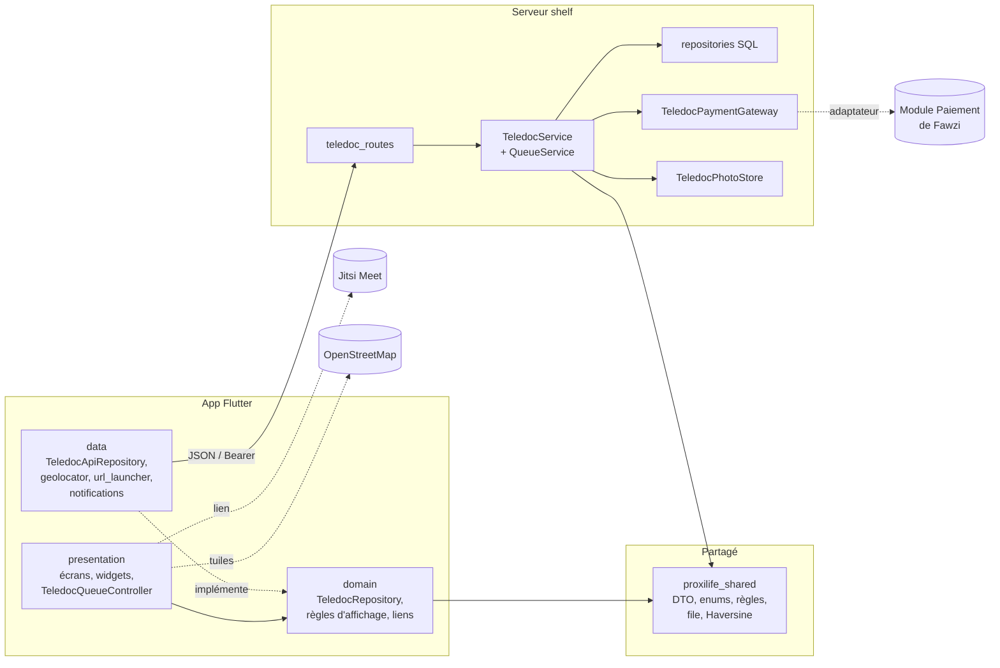

# TeleDoc Express : téléconsultation

Module de téléconsultation de ProxiLife. Un patient décrit ses symptômes (photo
facultative), paie 30 DT et entre dans une **file d'attente virtuelle** commune
à tous les médecins. Un médecin prend la tête de file, mène l'appel audio ou
vidéo, puis rédige l'ordonnance. Le patient l'envoie enfin à la **pharmacie de
garde la plus proche**.

- Conception détaillée (décisions D1–D43, diagrammes, API, sécurité) : [CONCEPTION.md](CONCEPTION.md)
- Branche : `feat/teledoc`

## 1. Fonctionnalités

| Besoin | Réalisation |
|---|---|
| CRUD demande de consultation | Créer (motif, description, urgence, photo), consulter, modifier tant qu'elle attend, annuler (remboursement). |
| CRUD consultation | Démarrer (tête de file), consulter, corriger l'ordonnance, terminer (ordonnance obligatoire), remettre en file ou « patient absent ». Une consultation terminée se modifie mais ne se supprime pas. |
| File d'attente virtuelle | Priorité (urgence, puis ancienneté), position et attente estimée **dérivées** (durée moyenne réelle des 20 dernières consultations, nombre de médecins actifs), polling toutes les 5 s, notifications locales « bientôt votre tour » et « le médecin vous attend ». |
| Appel audio / vidéo | Jitsi Meet (app ou navigateur), salle secrète de 128 bits par consultation, distribuée au seul patient et au seul médecin, tant que la consultation est ouverte. |
| Pharmacie de garde | GPS (repli sur Tunis centre), carte OpenStreetMap, distance Haversine côté serveur, itinéraire, appel, envoi de l'ordonnance à une pharmacie de garde. |
| Paiement | Passerelle `TeledocPaymentGateway` : mock par défaut, adaptateur réel vers le `PaymentService` de Fawzi prêt et testé (CONCEPTION §7.6). |

## 2. Lancer le module

Prérequis : Flutter (Dart ≥ 3.13), un émulateur Android (API 34 ou plus) avec Google Play.

```bash
# Dépendances (une fois)
cd packages/proxilife_shared && dart pub get
cd ../../server && dart pub get
cd ../app && flutter pub get

# Base de démo : comptes, 3 médecins, 8 pharmacies, 2 demandes d'exemple
cd ../server && dart run bin/seed.dart

# Terminal 1 : serveur (applique la migration TeleDoc si besoin)
dart run bin/server.dart
# Si le port 8080 est déjà pris (ex. Oracle XE) :
#   PowerShell : $env:SERVER_PORT="8081"; dart run bin/server.dart

# Terminal 2 : application
cd ../app
flutter run -d emulator-5554
# Avec le serveur sur 8081 :
#   flutter run -d emulator-5554 --dart-define=API_BASE_URL=http://10.0.2.2:8081
```

Options :

- `--dart-define=TELEDOC_JITSI_URL=https://…` : utiliser une autre instance Jitsi (auto-hébergée, sans compte modérateur).
- Position GPS de l'émulateur, à envoyer **une seule fois** avant d'ouvrir l'écran des pharmacies : `adb emu geo fix 10.3240 36.8790` (La Marsa).

## 3. Comptes de démo

Mot de passe commun : `Proxilife2026!`

| Rôle TeleDoc | E-mail | Nom |
|---|---|---|
| Patient | `client@proxilife.fr` | Ameni Guesmi |
| Médecin | `dr.bensalah@proxilife.fr` | Sami Ben Salah |
| Médecin | `dr.trabelsi@proxilife.fr` | Leila Trabelsi |
| Médecin | `dr.jaziri@proxilife.fr` | Karim Jaziri |

## 4. Scénario de démonstration (environ 10 minutes)

Deux appareils simulés : l'émulateur pour le patient, et soit un second
émulateur, soit le même après déconnexion, pour le médecin.

1. **Patient** (`client@proxilife.fr`) : sur l'accueil, la carte **TeleDoc Express** mène à « Nouvelle demande ».
2. Valider le formulaire vide pour montrer la validation (motif 3–80 caractères, description 10–1000). La même règle est revérifiée par le serveur.
3. Saisir « Fièvre », une description, l'urgence **Élevée**, puis ajouter une photo (appareil photo de l'émulateur). Le tarif de 30 DT est affiché ; envoyer.
4. L'écran **File d'attente** affiche la position, le nombre de patients et l'attente estimée. Activer les notifications.
5. *(Facultatif)* Créer une demande d'urgence faible avec un autre compte : la demande urgente reste devant, c'est la file à priorité.
6. **Médecin** (`dr.bensalah@proxilife.fr`) : la file est triée, en lecture seule, avec aperçu de la photo. Appuyer sur « Démarrer la prochaine consultation » puis choisir **Vidéo**. Le médecin ne choisit pas son patient : il prend la tête de file (règle d'équité).
7. **Patient** : en 5 s au plus, l'écran passe à « Le médecin vous attend » et une notification apparaît. Le bouton **Rejoindre l'appel vidéo** ouvre Jitsi.
8. **Médecin** : « Rejoindre l'appel vidéo » ouvre la même salle (sur meet.jit.si, le médecin se connecte une fois avec Google ou GitHub). Montrer « Passer en audio ».
9. **Médecin** : rédiger l'ordonnance, puis « Terminer et envoyer l'ordonnance ». Montrer ensuite « Corriger » (modification autorisée) et l'absence de suppression (dossier médical).
10. **Patient** : ouvrir « Voir l'ordonnance », puis **Trouver une pharmacie de garde**. Accepter la localisation : la carte et la liste triée par distance s'affichent. Montrer « Itinéraire » (app de cartes) et « Envoyer mon ordonnance ici ».
11. *(Robustesse)* Refuser la localisation : le repli sur Tunis centre et le bouton « Réglages » s'affichent. Couper le serveur pendant la file : le bandeau « Connexion perdue » apparaît, puis la reprise est automatique.

## 5. Guide de test

### 5.1 Tests automatisés (174 tests TeleDoc)

```bash
cd packages/proxilife_shared && dart analyze && dart test
cd ../../server && dart analyze && dart test     # arrêter le serveur avant
cd ../app && flutter analyze && flutter test
```

> Sous Windows, un serveur lancé verrouille `sqlite3.dll` et `dart test` échoue alors avec « Accès refusé ». Il faut arrêter le serveur avant les tests serveur.

| Paquet | Fichiers | Ce qui est vérifié |
|---|---|---|
| Partagé (35) | `teledoc_request_rules_test`, `teledoc_queue_test`, `teledoc_geo_and_validators_test`, `teledoc_call_room_test` | Machine à états (qui peut faire quelle transition), tri de la file et formule d'attente, Haversine, validateurs, format de la salle d'appel. |
| Serveur (60) | `teledoc_api_test`, `teledoc_queue_api_test`, `teledoc_schema_test`, `teledoc_payment_adapter_test`, `teledoc_photo_purge_test` | Toute l'API derrière la vraie authentification : rôles (403), visibilité (404), validation (400), conflits (409), paiement refusé (402). Concurrence de deux médecins, migrations v1→v3 et v2→v3, contrats avec le vrai `PaymentService`, nettoyage des photos. |
| App (79) | `teledoc_data_domain_test`, `teledoc_patient_screens_test`, `teledoc_queue_screen_test`, `teledoc_doctor_screens_test`, `teledoc_call_test`, `teledoc_pharmacy_test`, `teledoc_accessibility_test` | Couche données, écrans patient et médecin, polling et notifications, lien Jitsi, carte et GPS refusé, accessibilité (48 dp, libellés, contraste, police à 200 %). |

### 5.2 Vérifications manuelles (sur émulateur)

| # | Action | Résultat attendu |
|---|---|---|
| M1 | Envoyer une photo GIF ou de plus de 2 Mo | Refus en français ; aucun fichier stocké. |
| M2 | Deux demandes actives pour le même patient | 409 « Vous avez déjà une demande en cours ». |
| M3 | Patient : annuler une demande en cours de consultation | Impossible (seul le médecin peut l'interrompre). |
| M4 | Médecin : démarrer une 2ᵉ consultation sans finir la 1ʳᵉ | 409 « déjà une consultation en cours ». |
| M5 | Ouvrir l'appel après la fin de la consultation | Plus de bouton : la salle n'est plus distribuée. |
| M6 | Pharmacies avec la localisation refusée | Liste depuis Tunis centre, bandeau et bouton « Réglages ». |
| M7 | Police système au maximum (Réglages › Affichage) | Aucun texte coupé ni débordement sur les écrans TeleDoc. |
| M8 | Supprimer un compte patient, puis redémarrer le serveur au moins 1 h plus tard | Le journal indique « N photo(s) orpheline(s) supprimée(s) ». |

## 6. Architecture



- **Une seule source de vérité** : les règles (transitions, tri de la file, validateurs) sont dans `proxilife_shared`, utilisées par le serveur pour décider et par l'app pour afficher.
- **Fichiers partagés modifiés** (une ligne d'appel chacun) : `app.dart` (montage des routes), `database.dart` (version et migration), `bin/seed.dart`, `bin/server.dart` (nettoyage), `home_screen.dart` (carte d'entrée), `pubspec.yaml` et `AndroidManifest.xml` (dépendances et permissions de localisation, identiques à FoodSave), `.gitignore`.

## 7. Limites connues et points à remonter à l'équipe

- **Pas de push quand l'app est tuée** : Firebase est interdit par `AGENTS.md`. Les notifications arrivent tant que le processus vit (D31).
- **Paiement** : mock par défaut tant qu'un compte bénéficiaire n'est pas convenu avec Fawzi (§7.6). Sur `feat/payment`, la devise par défaut est passée à `EUR` alors qu'`AGENTS.md` impose `TND`.
- **Code partagé** : `PrimaryButton` déborde avec une grande police (libellé non `Flexible`), et `ServiceBadge` a un contraste de 3,15:1 sur « TeleDoc Express ». Signalés, non modifiés (D42).
- **Version de base** : FoodSave et TeleDoc utilisent tous deux la « version 2 ». La migration TeleDoc est idempotente (D36), et l'intégrateur choisit le numéro final à la fusion.
- **meet.jit.si** : le modérateur (médecin) doit se connecter une fois. Une instance auto-hébergée lève cette contrainte (`TELEDOC_JITSI_URL`).
